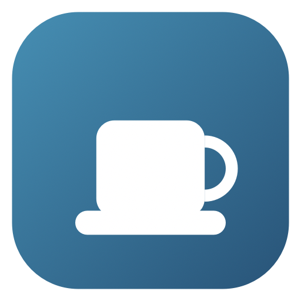

# Break Reminder for macOS

<p align="center">
  
</p>

<p align="center">
  <strong>A native macOS wellness and productivity companion designed to prevent eye strain, burnout, and fatigue.</strong><br>
  Built with Swift & SwiftUI • Multi-Monitor Soft-Blocking • Smart Meeting & Video Detection • 100% Privacy-First
</p>

---

## ⚡ Quick Download (Direct DMG)

If you just want to install and use the app without touching any code or developer tools:

📦 **Ready-to-Use DMG Installer**:
- **Location**: [`dist/BreakReminder-1.0.0.dmg`](file:/Documents/Break%20Reminder%20Mac/dist/BreakReminder-1.0.0.dmg)
- **Direct Workspace Path**: `/Users/karanraval/Documents/Break Reminder Mac/dist/BreakReminder-1.0.0.dmg`
- **Compatibility**: macOS 13.0 (Ventura), macOS 14 (Sonoma), macOS 15 (Sequoia) or newer (Apple Silicon & Intel)

---

## 📖 Table of Contents

1. [Beginner Installation Guide (Non-Coders)](#-beginner-installation-guide-non-coders)
   - [Step 1: Download & Open the DMG](#step-1-open-the-dmg-file)
   - [Step 2: Drag to Applications](#step-2-drag-to-applications)
   - [Step 3: First-Time Launch (macOS Gatekeeper)](#step-3-first-time-launch-macos-gatekeeper)
   - [Step 4: Where to Find the App (Menu Bar)](#step-4-where-to-find-the-app-menu-bar)
2. [Key Features Overview](#-key-features-overview)
3. [How to Use Break Reminder](#-how-to-use-break-reminder)
4. [Developer & Power-User Guide](#-developer--power-user-guide)
   - [System Requirements](#system-requirements)
   - [Build in Xcode](#build-and-run-in-xcode)
   - [Build from Terminal](#build-from-terminal)
   - [Generate a New DMG](#create-a-new-dmg-installer)
   - [Running Unit Tests](#running-unit-tests)
5. [Architecture & Project Structure](#-architecture--project-structure)
6. [Troubleshooting & Frequently Asked Questions (FAQ)](#-troubleshooting--faq)
7. [Privacy & License](#-privacy--license)

---

## 🍏 Beginner Installation Guide (Non-Coders)

You **do not** need Xcode, Visual Studio Code, Terminal, or any programming knowledge to install and use Break Reminder.

### Step 1: Open the DMG File
1. Locate the pre-built installer: **`BreakReminder-1.0.0.dmg`** in the `dist` folder.
2. Double-click the file to open (mount) it. A Finder window will pop up.

### Step 2: Drag to Applications
Inside the mounted disk window, simply drag the **Break Reminder** app icon and drop it directly onto the **Applications** shortcut folder.

```
+-------------------------------------------------------+
|  Break Reminder                                       |
|                                                       |
|      [ Break Reminder ]   -------->   [ Applications ]|
|            (App)                         (Folder)     |
|                                                       |
+-------------------------------------------------------+
```

Once copied, you can right-click the mounted `BreakReminder` disk on your desktop or Finder sidebar and choose **Eject "BreakReminder"**.

---

### Step 3: First-Time Launch (macOS Gatekeeper)

Because this build is distributed directly and signed locally without an Apple Developer subscription, macOS Gatekeeper may display a security alert:

> *"BreakReminder cannot be opened because the developer cannot be verified"* or *"Apple cannot check it for malicious software."*

This is standard macOS protection for indie open-source applications. You only need to approve it once:

#### Option A: The Right-Click Method (Easiest — No Terminal)
1. Open your **Applications** folder in Finder.
2. Find **Break Reminder** (or `BreakReminder.app`).
3. **Right-click** (or hold the `Control` key and click) on **Break Reminder**.
4. Select **Open** from the context menu.
5. A popup dialog will appear. Click the **Open** button.
6. The app will launch and will now open normally every time.

#### Option B: Via macOS System Settings
1. If you double-clicked the app and saw the alert, click **Cancel** or **Done**.
2. Open **System Settings** on your Mac.
3. Go to **Privacy & Security**.
4. Scroll down to the **Security** section.
5. You will see a message: *"BreakReminder was blocked from use because it is not from an identified developer."*
6. Click **Open Anyway** and confirm your Mac password or Touch ID.

#### Option C: Terminal Shortcut (For Power Users)
If you prefer the command line, open Terminal and run this one-line command:
```bash
xattr -cr /Applications/BreakReminder.app
```

---

### Step 4: Where to Find the App (Menu Bar)

Break Reminder is designed as a clean, unobtrusive menu bar utility:
- **It does not clutter your Dock**.
- Look at the **top-right menu bar** of your screen (near your Wi-Fi, battery, and clock icons).
- You will see the **Break Reminder icon** (timer/leaf).
- **Click the menu bar icon** to:
  - Start or pause your focus session.
  - Take an instant break.
  - Open the **Dashboard** to view detailed health metrics.
  - Open **Preferences** to customize intervals.

---

## 🌟 Key Features Overview

| Feature | Description |
| :--- | :--- |
| **Menu Bar Agent** | Runs quietly in the status bar (`LSUIElement = true`) without taking up space in the macOS Dock or App Switcher. |
| **Multi-Monitor Soft-Blocking Overlay** | Displays a soothing, full-screen wellness overlay across all active displays when it's time for a break. Hot-pluggable when external monitors are connected or removed. |
| **Smart Pause Engine** | Automatically pauses your timer when you're in a meeting (Zoom, Google Meet, Teams, FaceTime), watching a fullscreen video, or when your Mac is idle. |
| **Break Profiles** | Pre-configured modes for every workflow: **Balanced** (50m work / 5m break), **Deep Work** (90m work / 15m break), and **Eye Care (20-20-20)** (20m work / 20s break). |
| **Wellness Reminders** | Periodic non-intrusive alerts for eye strain (20-20-20 rule), posture correction, and hydration. |
| **Natural Break Detection** | If you step away from your computer for more than 5 minutes, Break Reminder credits the break automatically and resets your work cycle. |
| **Planned Breaks** | Schedule specific calendar breaks (e.g., Lunch at 1:00 PM, Afternoon Walk at 4:30 PM). |
| **Screen Score Dashboard** | Track your daily wellness score (0–100), sessions completed, breaks taken, and hours worked. |
| **Launch at Login** | Seamless startup via modern macOS `SMAppService` — keeps your healthy routine running automatically. |
| **Snooze & Strict Modes** | Need 5 more minutes to wrap up an email? Hit snooze. Want zero distractions? Turn on Strict Mode to hide the skip button. |
| **100% Offline & Private** | Zero telemetry, zero external network requests, zero data collection. All settings and history remain strictly on your Mac. |

---

## 💡 How to Use Break Reminder

### 1. Starting a Work Session
- Click the Break Reminder menu bar icon.
- Click **Start Work Session**.
- A subtle countdown appears in the menu bar.

### 2. When Break Time Arrives
- When your focus session completes, a chime will play and the **Wellness Overlay** will gently fade in on all your screens.
- Take a deep breath, stretch, look away from the monitor, or grab a glass of water.
- Controls available during a break:
  - **Snooze (+5m)**: Delays the break if you are in the middle of a critical task.
  - **Skip Break**: Skips to the next cycle (disabled in Strict Mode).
  - **Finish Break**: Ends the break immediately once refreshed.

### 3. Smart Pause in Action
- If you start a Zoom call or enter a Google Meet, Break Reminder detects it and puts the timer on hold so your presentation won't be interrupted.
- Once the meeting finishes, your session automatically resumes!

### 4. Customizing Durations
1. Click the menu bar icon -> **Preferences...** (or press `Cmd + ,`).
2. Adjust:
   - **Work Interval**: 5 to 180 minutes.
   - **Short Break**: 1 to 30 minutes.
   - **Long Break**: 5 to 60 minutes.
   - **Long Break Frequency**: Every 2 to 8 sessions.
   - **Sound Chimes**: Choose your preferred audio feedback or mute.

---

## 🛠 Developer & Power-User Guide

### System Requirements
- **macOS**: 13.0 (Ventura), 14.0 (Sonoma), or 15.0+ (Sequoia)
- **Xcode**: 15.0 or later (with Command Line Tools installed)
- **Swift**: 5.9+
- **Architecture**: Universal binary (Apple Silicon arm64 & Intel x86_64)

### Build and Run in Xcode

1. Clone or navigate to the repository directory:
   ```bash
   cd "/Users/karanraval/Documents/Break Reminder Mac"
   ```
2. Open the Xcode project:
   ```bash
   open BreakReminder.xcodeproj
   ```
3. In the top toolbar, select scheme **BreakReminder** and destination **My Mac**.
4. Press **`Cmd + R`** to build and launch in debug mode.

### Build from Terminal

To build a Release binary directly from the terminal:

```bash
xcodebuild -project BreakReminder.xcodeproj \
    -scheme BreakReminder \
    -configuration Release \
    -derivedDataPath .build/DerivedData \
    -destination 'platform=macOS' \
    build
```

The compiled application will be generated at:
`.build/DerivedData/Build/Products/Release/BreakReminder.app`

### Create a New DMG Installer

We provide an automated, production-ready packaging script:

```bash
./scripts/build-dmg.sh
```

This script will:
1. Compile the app in **Release** configuration using `xcodebuild`.
2. Stage the `.app` bundle alongside a `/Applications` symlink.
3. Ad-hoc codesign the bundle (or use Developer ID if credentials are provided).
4. Compress and produce a clean `.dmg` image in the `dist/` folder:
   - Output: `dist/BreakReminder-1.0.0.dmg`

#### Optional: Apple Developer ID Signing & Notarization
If distributing to public users with Apple Developer verification:

```bash
export DEVELOPER_ID_APPLICATION="Developer ID Application: Your Name (TEAM_ID)"
export NOTARIZE=true
export APPLE_ID="your.email@example.com"
export APPLE_PASSWORD="app-specific-password"
export TEAM_ID="TEAM_ID"

./scripts/build-dmg.sh
```

### Running Unit Tests

Run the full test suite covering timer recovery, state machines, multi-display handling, and smart detectors:

```bash
xcodebuild -project BreakReminder.xcodeproj \
    -scheme BreakReminder \
    -derivedDataPath .build/DerivedData \
    -destination 'platform=macOS' \
    test
```

Or press **`Cmd + U`** inside Xcode.

---

## 🏗 Architecture & Project Structure

```
BreakReminder/
├── App/
│   ├── BreakReminderApp.swift        # SwiftUI App entry point with MenuBarExtra
│   └── AppDelegate.swift             # NSApplicationDelegate lifecycle & activation policy
│
├── AppIntents/
│   └── BreakReminderIntents.swift    # macOS Shortcuts & Siri actions integration
│
├── Models/
│   ├── TimerState.swift              # TimerStatus, BreakType, TimerSnapshot
│   ├── AppSettings.swift             # User settings persistence & validation
│   ├── BreakProfile.swift            # Balanced, Deep Work, Eye Care profiles
│   ├── DailyStatistics.swift         # DailyRecord & AggregateStatistics models
│   ├── ScreenScore.swift             # Real-time wellness score computation
│   ├── SmartPauseModels.swift        # Pause reasons & trigger status
│   └── PlannedBreak.swift            # Scheduled daily break models
│
├── Managers/
│   ├── TimerManager.swift            # Wall-clock timestamp timer state machine
│   ├── BreakWindowManager.swift      # Multi-monitor soft-blocking NSWindow manager
│   ├── SmartPauseManager.swift       # Orchestrates idle, fullscreen, & video detectors
│   ├── Detectors/                    # Individual specialized hardware/OS detectors
│   │   ├── IdleDetector.swift        # System idle & user input monitoring
│   │   ├── MeetingDetector.swift     # Zoom, Teams, Meet, Webex conference detector
│   │   ├── FullscreenDetector.swift  # Native fullscreen space detection
│   │   ├── VideoPlaybackDetector.swift # Audio/video streaming playback detector
│   │   └── ScreenRecordingDetector.swift # Active recording / streaming detector
│   ├── WellnessReminderManager.swift # 20-20-20, posture, and hydration reminders
│   ├── NaturalBreakManager.swift     # Away-from-keyboard credit detector
│   ├── PlannedBreakManager.swift     # Scheduled calendar break executor
│   ├── OfficeHoursManager.swift      # Work-schedule bounds enforcement
│   ├── FloatingCountdownManager.swift# Compact floating overlay manager
│   ├── NotificationManager.swift     # UserNotifications engine
│   ├── SoundManager.swift            # AVFoundation & NSSound audio chimes
│   ├── StatisticsManager.swift       # Local session & wellness statistics
│   ├── LaunchAtLoginManager.swift    # Modern SMAppService auto-start
│   └── AppWindowManager.swift        # Managed single-instance AppKit windows
│
├── Views/
│   ├── MainWindowView.swift          # Modern tabbed dashboard & control panel
│   ├── MenuBarView.swift             # Rich menu bar popover interface
│   ├── BreakScreenView.swift         # Soothing full-screen multi-monitor overlay
│   ├── DashboardView.swift           # Standalone dashboard component
│   ├── SettingsView.swift            # Modular preferences view
│   ├── StatisticsView.swift          # Visual history & trend charts
│   ├── Modules/                      # Independent configuration tabs
│   │   ├── GeneralSettingsModuleView.swift
│   │   ├── ScreenBreaksModuleView.swift
│   │   ├── SmartPauseModuleView.swift
│   │   ├── WellnessModuleView.swift
│   │   ├── PlannedBreaksModuleView.swift
│   │   ├── OfficeHoursModuleView.swift
│   │   └── AppearanceModuleView.swift
│   └── Components/
│       ├── WellnessBackground.swift  # Dynamic ambient background animation
│       ├── ProgressRingView.swift    # High-precision circular countdown gauge
│       └── FloatingCountdownView.swift # Mini floating HUD timer
│
├── Utilities/
│   └── DateHelpers.swift             # Wall-clock time formatters & date calculations
│
└── Resources/
    ├── Assets.xcassets/              # AppIcon (16px to 1024px) & asset catalog
    ├── Info.plist                    # LSUIElement agent flag & app bundle metadata
    └── BreakReminder.entitlements    # Hardened runtime & sandboxing entitlements
```

---

## ❓ Troubleshooting & FAQ

#### Q1: I installed the app, but I don't see it in my Dock. Did it fail to open?
**Answer**: No! Break Reminder is intentionally configured as a **Menu Bar App** (`LSUIElement = true`). It does not appear in your Dock. Look at the very top of your screen on the right-hand side (next to the clock, Wi-Fi, and battery). You will see the Break Reminder icon there.

#### Q2: macOS says "BreakReminder cannot be opened because the developer cannot be verified." What do I do?
**Answer**: Right-click (or Control-click) **Break Reminder** in your **Applications** folder, select **Open**, and then click **Open** in the dialog. You only need to do this once. See [Step 3: First-Time Launch](#step-3-first-time-launch-macos-gatekeeper) for detailed visual steps.

#### Q3: Does the app keep running when I close the Preferences or Dashboard window?
**Answer**: Yes. Closing windows simply hides the settings interface. The countdown timer and break monitor remain active in the menu bar.

#### Q4: How do I completely quit Break Reminder?
**Answer**: Click the Break Reminder menu bar icon, click the gear/menu button, and select **Quit Break Reminder** (or press `Cmd + Q` while focused on the Dashboard window).

#### Q5: Will the break screen interrupt me during an important presentation or Zoom call?
**Answer**: No. The built-in **Smart Pause Engine** monitors for active video calls (Zoom, Microsoft Teams, Google Meet, FaceTime, Webex) and fullscreen presentations, automatically postponing breaks until your meeting ends.

#### Q6: How do I make Break Reminder start automatically when I turn on my Mac?
**Answer**: Click the menu bar icon -> **Preferences** -> **General** -> check **"Launch at Login"**.

#### Q7: How do I uninstall Break Reminder?
1. Quit the application from the menu bar.
2. Open Finder -> **Applications**.
3. Drag **Break Reminder** to the Trash (or press `Cmd + Delete`).
4. Empty your Trash.

---

## 🔒 Privacy & License

- **Privacy**: Break Reminder operates completely on-device. No telemetry, analytics, cookies, account logins, or network tracking exist in the codebase. Read our complete [`PRIVACY.md`](file:///Users/karanraval/Documents/Break%20Reminder%20Mac/PRIVACY.md).
- **License**: Released under the MIT License. See [PRIVACY.md](file:///Users/karanraval/Documents/Break%20Reminder%20Mac/PRIVACY.md) for details on data handling and privacy.
